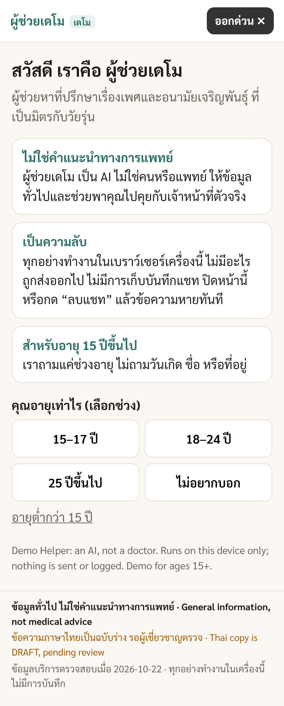
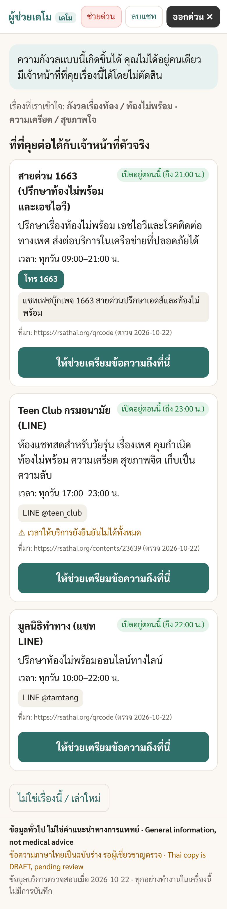
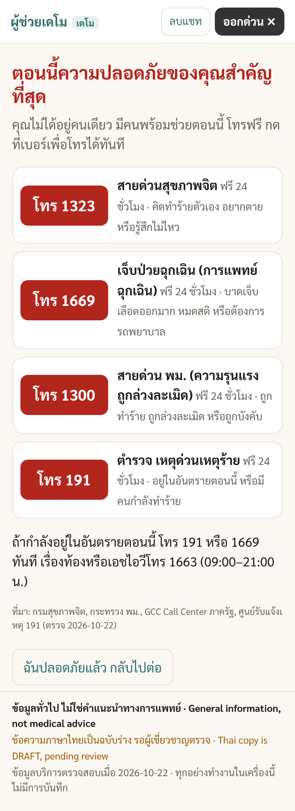

# Jane (พี่เจน)

Thai sexual-health information chat demo by [Opendream](https://opendream.co.th/).

Jane helps a person describe a need in Thai, checks for crisis language first, then suggests public services and a handoff summary. It is a **local demo**, not a clinic, not a counsellor, and **not medical advice**.

If the text looks like a crisis (self-harm, violence, emergency), Jane stops the normal flow and shows Thailand support lines with tap-to-call (`tel:`): **1323**, **1300**, **1669**, and **191**. Mixed or unclear crisis wording shows all four.

Minimum age for the demo is 15 (`MIN_AGE` in `src/config.ts`).

## Demo

Screenshots from the local e2e run live in `shots/`:

| Start | Suggestions | Crisis |
| --- | --- | --- |
|  |  |  |

More stills (handoff labelled **DEMO — nothing was sent**, under-age gate, model-loading pill) are in the same folder.

## What it does

The app works **without any model**.

1. Start screen: not medical advice, on-device privacy, age band, quick-exit on every screen.
2. The person types a need in Thai. Crisis rules run first (`src/core/crisis.ts`), then rule-based mapping, then 1–3 services from `src/data/services.json` with an open-now check in Asia/Bangkok.
3. A handoff summary is built from a fixed template with PII stripped. The person can edit, approve, or cancel.
4. Approve shows a simulated handoff screen labelled **DEMO — nothing was sent**, plus the real public channel as text (not a live send).
5. An optional on-device Qwen3 model can refine low-confidence routing and summary wording. Crisis detection stays rules-only.

## Setup and run

Needs Node.js 18+ (verified here on Node 22). The static server binds **127.0.0.1 only**.

```bash
npm ci
npm test           # vitest unit tests
npm run e2e        # build + Playwright (headless Chrome on 127.0.0.1:4173)
npm run dev        # http://127.0.0.1:5173  (hot reload)
npm run build && node scripts/serve.mjs   # http://127.0.0.1:4173
```

`npm run e2e` uses `/usr/bin/google-chrome` (override with `CHROME_PATH`). Step screenshots go to `e2e-shots/` (gitignored). The WASM model e2e test is skipped when weights are not installed.

Optional filming bundle: `python3 scripts/make-bundle.py` → see `bundle/README-RUN.md`.

## Model setup

Weights are **never in this repository**. The demo runs on rules if they are missing.

To fetch the default Qwen3-1.7B builds (WebGPU + WASM GGUF, about 2.1 GB), from their official pinned sources:

```bash
node scripts/fetch-weights.mjs
# optional larger WebGPU model:
node scripts/fetch-weights.mjs --model qwen3-4b
```

| `MODEL` (`src/config.ts`) | WebGPU | WASM (CPU) | Official source |
| --- | --- | --- | --- |
| `qwen3-1.7b` (default) | MLC q4f16 / q4f32 ~0.99 GB | GGUF Q4_K_M 1.11 GB | [Qwen3-1.7B](https://huggingface.co/Qwen/Qwen3-1.7B), [MLC build](https://huggingface.co/mlc-ai/Qwen3-1.7B-q4f16_1-MLC), [unsloth GGUF](https://huggingface.co/unsloth/Qwen3-1.7B-GGUF) |
| `qwen3-4b` | MLC q4f16 / q4f32 ~2.29 GB | falls back to 1.7B | [Qwen3 blog](https://qwenlm.github.io/blog/qwen3/) |
| `off` | none | none | rules only |

Files land in `models/` (gitignored) after sha256 checks against `scripts/weights-manifest.json`. The app loads them from `/models/` on 127.0.0.1 into Cache Storage (`model-weights-v1`, model files only). Testing overrides: `?model=off`, `?runtime=webgpu`, `?runtime=wasm`.

Qwen3-0.6B, Qwen3.5 0.8B/2B, and Gemma are **not** fetched by the default-branch scripts. See `THIRD_PARTY.md`.

## Safety notes

- Eval and unit tests use **synthetic** prompts only. Do not commit real chat logs.
- **No logging of user messages.** Chat state is in memory. The static server does not receive chat content. There is no `console` logging of user text.
- **No image upload.** There is no file input.
- No `fetch`/XHR in the app; strict CSP (`default-src 'self'`). Source URLs are shown as text, not links.
- Nothing user-identifying is written to localStorage, IndexedDB, or cookies. sessionStorage may hold a single non-personal `jane.webgpu.failed` flag after a WebGPU device loss. Cache Storage holds model files only.
- Quick-exit and erase drop in-memory state.

## Licence

The **code** is under the Apache License 2.0 (see the root `LICENSE`). `package.json` `license` is `Apache-2.0`. The **answer-bank text** (cards under `src/data/bank/`: `answer_th`, titles, variants, key facts, triggers, chip labels) is licensed CC BY-SA 4.0 (see `src/data/bank/LICENSE`; attribution Opendream). That CC BY-SA grant covers the answer-bank text only: it does not cover illustrations, art, images, sprites, or the brand mark. The **eval question set** (`evals/` item files) is separately licensed CC BY-SA 4.0 as text (see `evals/LICENSE`; attribution Opendream). Quiz content is adapted from 'Judies, Opendream 2017' (Opendream owns Judies and relicenses its quiz content under CC BY-SA 4.0).
Illustration © Opendream, 2018. Some figures redrawn with AI assistance, 2026.
Art: 2018 *Sex Safe Safe* vector stars and approved figures in `src/assets/jane/` (all rights reserved; not covered by Apache-2.0 or CC BY-SA). Never use the 2020 Jane art. UI font is self-hosted Mitr (SIL OFL 1.1, Cadson Demak). Third-party models and other notices: `NOTICE` and `THIRD_PARTY.md`.

## Contact

Opendream — https://opendream.co.th/en/contact_en — info@opendream.co.th
